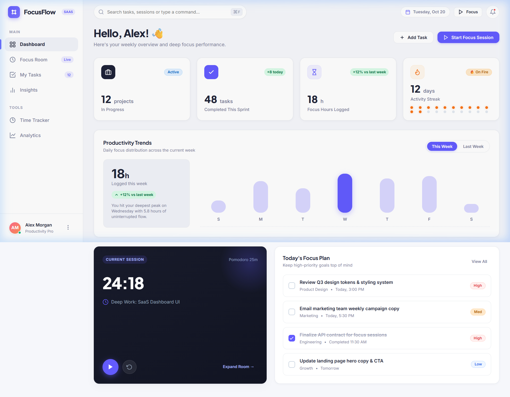
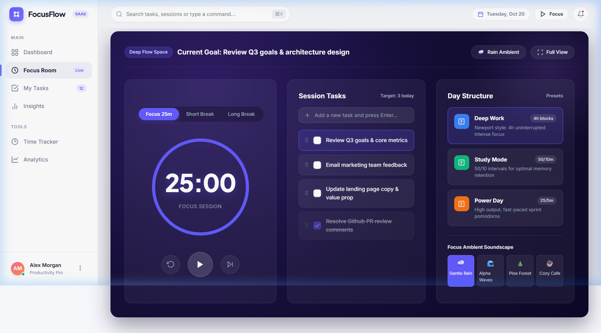
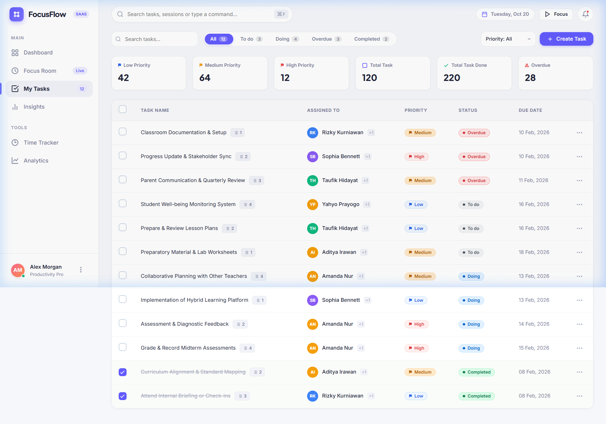

#  FocusFlow SaaS UI

> A modern productivity and focus-tracking SaaS dashboard built with Astro, SCSS, and HTML5. UI-focused project featuring responsive layouts, analytics cards, deep work focus sessions with YouTube soundscapes, and clean task management.

<p align="left">
  
  
  
  
</p>

---

## 🌟 Project Overview

**FocusFlow** is designed to solve digital distraction and fragmented daily planning by merging high-leverage focus sessions, goal tracking, and productivity analytics into one cohesive, distraction-free SaaS experience.

Built **UI-First** to master modern web layout architecture, responsive Flexbox/Grid design, CSS tokens, and component reusability within **ASP.NET Core MVC** without heavy runtime dependencies like React, Tailwind, or complex databases.

---

## 📸 Screenshots & Previews

### 01. Dashboard (`/`)

_Greeting, 4 KPI cards, interactive CSS weekly focus bar chart, live time tracker widget, and today's priority plan._


---

### 02. Focus Room (`/Focus`)

_Cosmic dark-mode distraction-free flow state, circular countdown timer with animated SVG ring progress, session tasks, day structure presets, and ambient soundscapes synthesized via Web Audio API._


---

### 03. My Tasks (`/Tasks`)

_Comprehensive SaaS table layout featuring status metric chips, priority badges, category filters, interactive completion checkboxes, and dynamic task creation modal._


---

## 🚀 Key Features

| Screen         | Route       | Key UI Components                                                                                                                                                                                                                                    |
| -------------- | ----------- | ---------------------------------------------------------------------------------------------------------------------------------------------------------------------------------------------------------------------------------------------------- |
| **Dashboard**  | `/`         | Greeting banner, 4 KPI metric cards (Projects, Tasks, Hours, Dot streak matrix), weekly focus bar chart, quick 25m time tracker widget, and today's priority plan.                                                                                    |
| **Focus Room** | `/focus`    | Mode tabs (`Focus 25m`, `Short Break 5m`, `Long Break 15m`), circular SVG radial timer, start/pause/reset/skip controls, checkable goal queue, draggable session tasks, and YouTube ambient soundscape engine (Rain, Waves, Forest, Cafe).           |
| **My Tasks**   | `/tasks`    | Top search bar, filter tabs (`All`, `To do`, `Doing`, `Completed`), priority filter, metric summary chips, clean data table with avatars, more options dropdown menu, and interactive "+ Create Task" modal.                                       |

---

## 🎨 Design System & Color Palette

The UI utilizes a tailored SaaS design token system defined in CSS variables (`wwwroot/css/site.css`):

- **Primary**: `#635BFF` (Stripe-inspired vivid indigo)
- **Background**: `#F6F7FB` (Light neutral slate)
- **Text Main**: `#202438` (Deep navy charcoal)
- **Card Surface**: `#FFFFFF` (Card radius: `16px`, soft elevation shadows)
- **Success**: `#0E7A4A` (Background: `#D9FBE7`)
- **Warning**: `#B35C00` (Background: `#FFE9CB`)
- **Danger**: `#D9383A` (Background: `#FEE7E7`)
- **Typography**: `Inter` and `Plus Jakarta Sans` via Google Fonts.

---

## 🛠️ Technology Stack

- **HTML5 & Razor Views**: Semantic markup and layout templating (`_Layout.cshtml`, `_Sidebar.cshtml`).
- **CSS3 (Pure Vanilla)**: Custom Flexbox, CSS Grid, CSS Variables, SVG curves, keyframe animations, and custom scrollbars (no Tailwind dependency).
- **C# / ASP.NET Core MVC**: Clean Controller-ViewModel architecture rendering mock data models.
- **JavaScript (Vanilla)**: Non-intrusive interactive widgets:
  - Circular timer countdown with SVG stroke-dashoffset animation.
  - Native Web Audio API pink/brown noise rain synthesizer for focus soundscapes.
  - Client-side table filtering, search, and dynamic task modal creation.
  - Keyboard shortcuts (`⌘ F` / `Ctrl+K`) and mobile drawer offcanvas menu.

---

## 📁 Repository Structure

```
focusflow-saas-ui/
├── Controllers/
│   ├── HomeController.cs        # Renders Dashboard with weekly trends & tasks
│   ├── FocusController.cs       # Renders Focus Room with day structures & presets
│   ├── TasksController.cs       # Renders Tasks table with metric summary chips
│   └── InsightsController.cs    # Renders Analytics, wave chart & completion donut
├── Models/
│   ├── FocusSession.cs          # Focus session data model
│   └── TaskItem.cs              # Task item data model (priority, status, assignee)
├── ViewModels/
│   ├── DashboardViewModel.cs    # View model for Home dashboard
│   ├── FocusViewModel.cs        # View model for Focus Room
│   ├── TasksViewModel.cs        # View model for Tasks table
│   └── InsightsViewModel.cs    # View model for Insights analytics
├── Views/
│   ├── Home/Index.cshtml        # Dashboard view
│   ├── Focus/Index.cshtml       # Focus room view with circular timer
│   ├── Tasks/Index.cshtml       # Task table view with create modal
│   ├── Insights/Index.cshtml    # Insights view with SVG wave chart
│   └── Shared/
│       ├── _Layout.cshtml       # Global SaaS app shell & header
│       └── _Sidebar.cshtml      # Reusable sidebar navigation
├── wwwroot/
│   ├── css/
│   │   ├── site.css             # CSS variables, color tokens, typography
│   │   ├── layout.css           # App shell, sidebar, top header, responsive breakpoints
│   │   ├── components.css       # Cards, badges, buttons, checkboxes, modal, tabs
│   │   └── pages/
│   │       ├── dashboard.css    # Dashboard KPI & bar chart styles
│   │       ├── focus.css        # Cosmic dark theme focus room styles
│   │       ├── tasks.css        # SaaS data table & metric chips styles
│   │       └── insights.css     # Wave chart, donut ring & insight cards
│   ├── js/
│   │   └── site.js              # Mobile navigation drawer & shortcuts
│   └── images/                  # High-resolution screenshots of completed pages
├── Program.cs                   # Application entry point
├── FocusFlow.csproj             # .NET 10 project file
└── README.md
```

---

## 💻 Getting Started Locally

### Prerequisites

- [Node.js](https://nodejs.org/) (v18+ or v22+)
- npm or pnpm

### Steps to Run

1. Clone the repository:

   ```bash
   git clone https://github.com/phuctran1501/focusflow-saas-ui.git
   cd focusflow-saas-ui
   ```

2. Install dependencies:

   ```bash
   npm install
   ```

3. Run the development server:

   ```bash
   npm run dev
   ```

4. Open your browser and navigate to:
   ```
   http://localhost:4321
   ```

5. Build production bundle (optional):
   ```bash
   npm run build
   ```

---

## 🎯 Learning Outcomes

- **Design Systems & CSS Architecture**: Structured maintainable CSS using variables, utilities, and page-specific isolation.
- **Advanced Responsive Layouts**: Fluid responsive transitions across desktop, tablet, and mobile offcanvas drawers using CSS Grid and Flexbox.
- **Component Reusability**: Created reusable Razor layouts, sidebars, badges, tabs, and modal components.
- **Lightweight SVG Data Visualization**: Implemented custom bar charts, spline wave curves, and donut charts without third-party chart libraries.
- **Web Audio API**: Implemented ambient audio generation directly in the browser.

---

## 📄 License

This project is open-source under the [MIT License](LICENSE).
